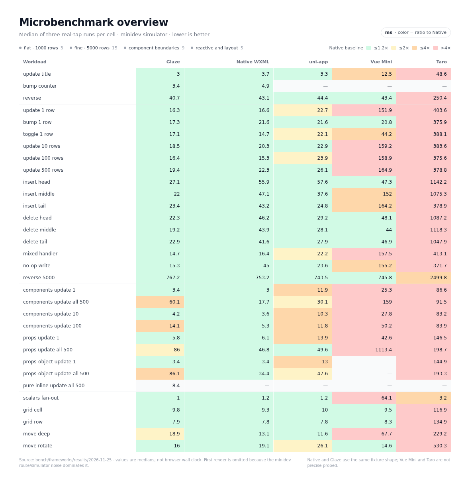

# Glaze

English | [简体中文](README.zh-CN.md)

**Solid and Svelte, running natively on glass-easel.**

Glaze compiles modern web frameworks to native mini-program WXML and runs only
their reactive logic at runtime. No virtual DOM, no generic recursive template,
and no `setData` for unrelated state.

The first target is **Solid 2**. Svelte 5 is planned on the same compiler.

## What is glass-easel?

[glass-easel](https://github.com/wechat-miniprogram/glass-easel) is WeChat Mini
Program's open-source, next-generation component framework. It is the runtime
behind the newer component model: components, templates, data updates, events
and slots are handled by glass-easel instead of the legacy Exparser layer. The
WebView renderer supports it from base library **3.8.12**; Skyline supports only
glass-easel. Enabling it requires `componentFramework: "glass-easel"` and
`window.glassEaselWebview: true` (see [Build](docs/build.md)).

Glaze targets glass-easel directly. It emits WXML/WXSS/JSON and small JS modules
that define glass-easel components; it does not replace the platform renderer.
An opt-in compatibility mode runs the same output on the legacy Exparser
framework for older base libraries (see [Legacy exparser](docs/exparser.md)).

## Why "Glaze"?

A glaze is a thin, hard, transparent layer fused onto glass: it does not replace
the glass, it changes how the surface behaves. Glaze is the same idea for
glass-easel: a thin compile-and-reactivity layer over the platform renderer.

The name also keeps the family relationship visible: **glass**-easel is the
substrate, **Glaze** is what runs on it.

## Project characteristics

- **Compile-first template generation.** Solid JSX becomes WXML at build time.
  There is no Taro-style DOM shim and no generic recursive template at runtime.
- **Component boundaries are deliberate.** Framework components are inlined in
  the page tree; only pages and real mini-program interop points become
  glass-easel components. There is no per-component props/data bridge for every
  Solid component.
- **Signal updates become data paths.** A signal update writes a binding path
  (`b3[0].done`) or a list splice through glass-easel's `DataGroup`; unrelated
  state is not serialized.
- **One shared runtime.** Components share `glaze-runtime/index.js`; only
  `independent: true` subpackages carry their own copy.
- **Tooling is part of the compiler.** `glaze build`, `glaze watch`,
  `glaze snippet`, a Vite bridge, optional Tailwind 4 and build-time
  SCSS/Less compilation are in the same pipeline.
- **Narrow on purpose.** The current target is WeChat + glass-easel + Solid 2.
  Dynamic components, render props/HOC, arbitrary `.map()` JSX, Portal,
  Transition and a full DOM-like ref are explicit non-goals for now.
- **No silent fallback.** Unsupported JSX is a compile error rather than a
  silent switch to a different runtime path.

## Status

Working spike, not a production framework. It covers:

- Solid 2 control flow: `For` (all keyed modes, `fallback`, nested), `Show`
  (including callbacks and `fallback`), `Switch`/`Match`, `Repeat`,
  destructuring, static spread, `class`/`style` helpers;
- components: props, default and named slots, custom events (including
  `catch`/`capture`/`mut-bind`), recursive inlining protection, context across
  component boundaries (object values stay reactive), ref measurement, node
  queries, focus/blur and attribute access;
- async: memoized async bindings, `Loading`/`Errored` with nested boundaries,
  `Loading on`, `Errored` reset, pending/error projection;
- build: pages, subpackages (including independent), per-page config, shared
  runtime, assets, Tailwind 4, SCSS/Less, incremental `watch`, Vite bridge and
  single-file snippets;
- data: keyed lists project only the fields WXML reads, so unused row payload
  never crosses the `setData` boundary; Glaze-to-Glaze child props cross the
  component boundary as one internal object property;
- stores: `@glaze/store` adds lazy, app-wide setup stores over
  `solid-js/store`, with one instance per id across every component bundle;
- UI: `@glaze/ui` ports UI SDK primitives (button, toggle, switch, field,
  input, dialog, checkbox, radio, tabs, collapsible) as native WXML
  components, including uncontrolled variants and a touch-only dialog;
- validation: 643 unit tests (shared 2, store 8, runtime 204, compiler 303,
  build 126), glass-easel rendering tests and 12 minidev e2e cases.

Known limits are documented in [Compiler](docs/compiler.md),
[Store](docs/store.md), [UI SDK port](docs/ui.md), [Build](docs/build.md)
and [Optimizations](docs/optimizations.md). The
compiler/runtime structural refactor is recorded in
[Code quality](docs/code-quality-refactor.md).

## Benchmarks

The overview covers every microbenchmark workload (flat/fine list actions,
component and prop boundaries, pure inline rows, scalars, grid and keyed
moves), not only the page-root prop-shape case. Each cell is the median of
three real-tap runs; color is the ratio to native WXML. Rows marked `†` use
Glaze's page root; the other Glaze rows use the component root. First render is
omitted because minidev routing and simulator noise dominate it. The raw results
and the `bench/frameworks/chart.mjs` renderer are in the repository.

Some Glaze wins are framework semantics rather than a different fixture: the
compiler projects only fields WXML reads, list updates use splices, and an
unchanged list is short-circuited. Those are valid advantages for the default
idiom used here, but not an upper bound for a hand-optimized native page. The
native `fine` insert/delete handlers resend all 5000 rows including the unused
2 KB `extra` field, and native `no-op` resends the whole array; the chart
compares Glaze's default idiom with an idiomatic native implementation, not a
general framework ranking.

These are **same-harness** numbers: Glaze versus a hand-written
WXML/WXSS/JS page, measured in the minidev simulator with the automator. They
include page routing and automator round-trips, so they compare the two pages
within one session; they are not device timings and not comparable with phone
benchmarks from other projects.

Flat 1000-row list (three runs, `minidev` 0.18.0, base library 3.17.3, headless
Chromium 1248):

| Case | Glaze | Native WXML |
| --- | ---: | ---: |
| First render | 3210-3250 ms | 3196-3212 ms |
| One scalar update | 92-96 ms | 92-93 ms |
| Keyed reverse | 65-71 ms | 67-68 ms |

Component-dense page: 1000 pure rows + 1000 stateful rows (means of three
runs):

| Case | Glaze | Native WXML | Reading |
| --- | ---: | ---: | --- |
| First render (2000 component hosts) | 3584 ms | 3595 ms | within run spread |
| First pure-row field update | 30 ms | 32 ms | at the polling floor |
| Toggle all 1000 rows | 58 ms | 73 ms | faster in this harness |
| State-row click | 25 ms | 26 ms | at the polling floor |
| Append one pure row | 269 ms | 253 ms | Glaze slower; not a win |
| Delete first pure row | 191 ms | 180 ms | Glaze slower; not a win |
| Reverse 1000 rows | 417 ms | 451 ms | faster in this harness |

Edge-case page (10 chains × 10 nested components, 20 independent inputs, 100
slot cards, 100 custom-event rows; means of three runs) adds one combined
first-render number and at-the-floor update numbers:

| Case | Glaze | Native WXML | Reading |
| --- | ---: | ---: | --- |
| First render, all four cases ready | 3280 ms | 3209 ms | Glaze +2.2% |
| Deep leaf update | 22 ms | 22 ms | at the polling floor |
| Form: 10 chars into last input | 32 ms | 35 ms | at the polling floor |
| Slot: first card text update | 69 ms | 71 ms | at the polling floor |
| Custom event: one click round-trip | 23 ms | 22 ms | at the polling floor |

The first-render number covers the whole combined page, not each case. The
native deep side uses 100 plain nested views because WXML cannot recurse, while
Glaze uses 100 component instances, so it is not instance-for-instance
identical. The full protocol, per-run values and caveats (stale DOM across
`reLaunch`, `input()` not real keystrokes, no `setData` byte counts) are in
[Optimizations](docs/optimizations.md).

## How it compares

This is an architectural comparison, not a measured cross-framework benchmark.
Taro, uni-app and Vue Mini are mature projects with different goals; Glaze is a
narrow single-platform spike. No apples-to-apples performance number is claimed
for the other frameworks here.

| Framework | Model | What runs at runtime | Boundaries / updates | Official platforms |
| --- | --- | --- | --- | --- |
| [Taro 4.3.3](https://github.com/NervJS/taro) | compile + runtime (Taro 3 model); optional CompileMode | React/Vue + Taro DOM/BOM; serialized template + `setData` | page `setData`; `baseLevel`/`CustomWrapper` for local updates | H5, RN, many mini-programs, ASCF |
| [uni-app](https://github.com/dcloudio/uni-app) | compile + per-platform runtime | mini-program Vue runtime; `.vue` split into WXML/WXSS/JS | component split needed for local updates; otherwise page-level | iOS, Android, HarmonyOS Next, Web, many mini-programs |
| [Vue Mini 1.2.16](https://github.com/vue-mini/vue-mini) | runtime only | `@vue/reactivity` + host `setData`; no VDOM, no compiler | reactivity bound to the hosting page/component `setData` | WeChat only |
| **Glaze (spike)** | compile Solid JSX → WXML + binding runtime | Solid root per stateful component; binding effects only | pure components inline; stateful children are native components; path/splice `DataChange` queue | glass-easel WebView (WeChat); Skyline not validated |
| Native glass-easel | hand-written WXML/WXSS/JS | platform component framework | manual `setData`; per-component Shadow tree | WeChat WebView (base library 3.8.12+) / Skyline |

Versions above were checked against npm/GitHub releases in November 2026. Platform
lists and internals are vendor documentation, not measured here. The trade-off
is deliberate: Taro and uni-app optimize for framework coverage, multi-platform
reach and ecosystem compatibility, so a runtime layer is the practical choice.
Glaze optimizes for one narrow target where the component tree can be decided at
build time. If Glaze later needs arbitrary dynamic component trees or
third-party React/Vue component libraries, it will need an explicit runtime
fallback rather than pretending the compiler can cover everything.

## Packages

| Package | Role |
| --- | --- |
| `@glaze/compiler` | Solid JSX to WXML + binding runtime |
| `@glaze/build` | `glaze build`: project, page and subpackage output |
| `@glaze/shared` | Small shared helpers (string/path naming) |
| `@glaze/runtime` | per-instance Solid root and binding bridge |
| `@glaze/store` | lazy app-wide stores over `solid-js/store` |
| `@glaze/ui` | native WXML primitives modelled on vercel-labs/ui |
| `@glaze/vite-plugin` | Vite build bridge |
| `examples/solid-todo` | counter, todo list, async/context/Tailwind probes and benchmarks |

## Documentation

- [Architecture](docs/architecture.md)
- [Source layout](docs/source-layout.md)
- [Compiler](docs/compiler.md)
- [Runtime edge behavior](docs/runtime.md)
- [Page runtime](docs/page-runtime.md)
- [Store](docs/store.md)
- [UI SDK port](docs/ui.md)
- [Implementation plan](docs/plan.md)
- [Build](docs/build.md)
- [Legacy exparser framework](docs/exparser.md)
- [Single-file snippets](docs/snippet.md)
- [Tailwind CSS](docs/tailwind.md)
- [Testing below minidev](docs/glass-easel-testing.md)
- [Running with minidev](docs/minidev.md)
- [Performance backlog](docs/optimizations.md)
- [Why external components do not work](docs/findings-external-component.md)
- [Framework comparison fixtures](bench/frameworks/README.md)
- [Agent skill for Glaze source](skills/glaze-solid-miniprogram/SKILL.md)

## License

MIT
