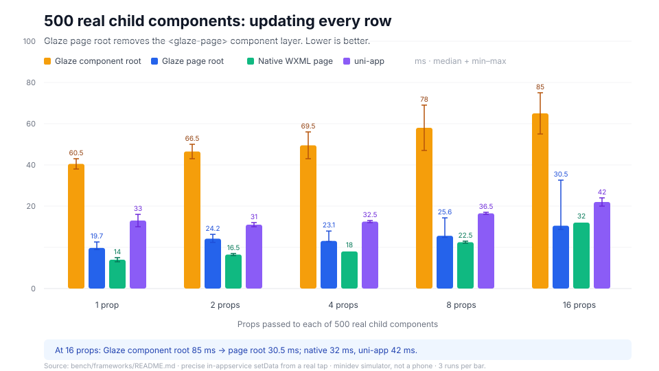

# Framework benchmark fixtures

Exploratory, same-machine comparison of mini-program list pages across Glaze,
Vue Mini, Taro and uni-app. It answers two questions:

1. can these frameworks run in minidev at all;
2. which page shapes expose real architectural costs, not just routing noise.

This is diagnostic, not a production benchmark. The production benchmark remains
the same-harness Glaze/native suite in `docs/optimizations.md`.

## Fixtures

| App | Stack | Build | Routes |
| --- | --- | --- | --- |
| `apps/vue-mini` | `@vue-mini/core 1.2.16`, official create-vue-mini build | `pnpm install && pnpm build` | `pages/home/index` (flat), `pages/fine/index` (rich rows), `pages/components/index` (500 row components), `pages/scalars/index`, `pages/grid/index`, `pages/move/index`, `pages/props/index` |
| `apps/taro` | Taro 4.3.3, React 18, **Vite compiler** | `pnpm install && pnpm build:weapp` | `pages/index/index`, `pages/fine/index`, `pages/components/index`, `pages/scalars/index`, `pages/grid/index`, `pages/move/index`, `pages/props/index`, `pages/props-object/index` |
| `apps/uni-app` | uni-app Vue3 Vite preset `3.0.0-5030420261029002` | `pnpm install && pnpm build:mp-weixin` | `pages/index/index`, `pages/fine/index`, `pages/components/index`, `pages/scalars/index`, `pages/grid/index`, `pages/move/index`, `pages/props/index`, `pages/props-object/index` |
| Glaze | `examples/solid-todo` | repository `pnpm build` | `pages/bench/index`, `pages/bench-fine/index`, `pages/bench-component-rows/index`, `pages/bench-component-rows-pure/index`, `pages/bench-scalars/index`, `pages/bench-grid/index`, `pages/bench-move/index`, `pages/bench-props/index`, `pages/bench-props-object/index` |
| Native | `examples/solid-todo/src/static/pages/*` | repository `pnpm build` | `pages/native/index`, `pages/native-fine/index`, `pages/native-fine-projected/index`, `pages/native-component-rows/index`, `pages/native-scalars/index`, `pages/native-grid/index`, `pages/native-move/index`, `pages/native-props/index`, `pages/native-props-object/index` |

The **flat** pages render 1000 `.row` elements and expose `#title`, `#update`
and `.reverse` in every implementation. Glaze/native use `.bump`/`.tick` class
selectors instead of ids for the optional scalar bump control.

The **fine** pages render 5000 `.row` elements. Each row also carries
`extra: 'x'.repeat(2000)`, which is data, not rendered text. They expose:

- `#bump` — increment `tick` only
- `#update` — change `rows[0].title`
- `#toggle` — change `rows[0].done`
- `#insert` — prepend a row
- `#delete` — delete the first row
- `.reverse` — reverse the list

Every app has a `pages/blank/index` neutral route for a reLaunch before the
timed route.

The **component** pages render 500 real child components, each with `title` and
`index` props plus a local counter. This forces every framework to keep a real
component boundary per row; the Glaze `-pure` variant uses an inlinable row
component instead, to show the cost of that boundary. They expose:

- `#update` — change only `rows[0].title` (one child prop update)
- `#update-all` — change all 500 titles (all child props update)
- `#last` — text of the last row title, used to wait for the update

Because the row text lives inside each child component's shadow root, the
runner counts the `.row-card` host elements. Use `.row-title` for `--first-text`
and `#last` for `--last-text`; the automator reaches the host text through the
shadow root.

## Run a fixture

Build the app, then make a minidev simulator distribution and start its server:

```bash
# Vue Mini
cd bench/frameworks/apps/vue-mini
pnpm install
pnpm build

# Taro: use the Vite compiler in config/index.js. Webpack5 currently fails in
# minidev with "Cannot access '_raf' before initialization".
cd ../taro
pnpm install
pnpm build:weapp

# uni-app
cd ../uni-app
pnpm install
pnpm build:mp-weixin
```

For each app, point minidev at the build output (or at the project root when
`project.config.json` already contains `miniprogramRoot`):

```bash
cd ~/Playground/minibuild
target/debug/minidev sim build --project <project-or-output> --out <sim-dist>
target/debug/minidev sim serve --dist <sim-dist> \
  --browser ~/.cache/ms-playwright/chromium_headless_shell-1248/chrome-headless-shell-linux64/chrome-headless-shell \
  --port 9440
```

Then measure. `NODE_PATH` must point at the minidev SDK that contains
`minidev-automator`:

```bash
# Flat page, 1000 rows, every action
NODE_PATH=~/Playground/minibuild/sdk node bench/frameworks/run.mjs \
  --port 9440 --route /pages/home/index --neutral /pages/blank/index \
  --count 1000 --update '#update' --last 'Row 999' --runs 3
```

```bash
# Rich-row page, 5000 rows, all actions
NODE_PATH=~/Playground/minibuild/sdk node bench/frameworks/run.mjs \
  --port 9440 --route /pages/fine/index --neutral /pages/blank/index \
  --count 5000 --bump '#bump' --update '#update' --toggle '#toggle' \
  --insert '#insert' --delete '#delete' --last 'Row 4999' --runs 3
```

Glaze pages use `--root '#app'`; native has no root selector. Pass the matching
tick selectors because the flat Glaze/native pages use classes:

```bash
NODE_PATH=~/Playground/minibuild/sdk node bench/frameworks/run.mjs \
  --port 9446 --route /pages/bench/index --neutral /pages/index/index \
  --root '#app' --count 1000 --bump '.bump' --tick '.tick' \
  --update '#update' --last 'Item 999' --runs 3
NODE_PATH=~/Playground/minibuild/sdk node bench/frameworks/run.mjs \
  --port 9446 --route /pages/bench-fine/index --neutral /pages/index/index \
  --root '#app' --count 5000 --bump '#bump' --update '#update' \
  --toggle '#toggle' --insert '#insert' --delete '#delete' --last 'Row 4999' --runs 3
NODE_PATH=~/Playground/minibuild/sdk node bench/frameworks/run.mjs \
  --port 9446 --route /pages/native-fine/index --neutral /pages/index/index \
  --count 5000 --bump '#bump' --update '#update' --toggle '#toggle' \
  --insert '#insert' --delete '#delete' --last 'Row 4999' --runs 3
NODE_PATH=~/Playground/minibuild/sdk node bench/frameworks/run.mjs \
  --port 9446 --route /pages/native-fine-projected/index --neutral /pages/index/index \
  --count 5000 --bump '#bump' --update '#update' --toggle '#toggle' \
  --insert '#insert' --delete '#delete' --last 'Row 4999' --runs 3
```

```bash
# Component page, 500 stateful row components
NODE_PATH=~/Playground/minibuild/sdk node bench/frameworks/run.mjs \
  --port 9440 --route /pages/components/index --neutral /pages/blank/index \
  --count 500 --row '.row-card' --first-text '.row-title' \
  --update '#update' --update-all '#update-all' --title '#title' \
  --last-text '#last' --skip-reverse --runs 3
```

For the Glaze stateful and pure variants, use the same command with
`--root '#app'` and the matching `--route`
(`/pages/bench-component-rows/index` or
`/pages/bench-component-rows-pure/index`); for native use
`/pages/native-component-rows/index` without `--root`.

```bash
# Props page: automatic structured props (500 boundaries, a..h)
NODE_PATH=~/Playground/minibuild/sdk node bench/frameworks/run.mjs \
  --port 9445 --route /pages/bench-props/index --neutral /pages/index/index \
  --root '#app' --count 500 --row '.row-card' --first-text '.row-title' \
  --update '#update' --update-all '#update-all' --title '#title' \
  --last-text '#last' --skip-reverse --runs 3

# Props object A/B: one `row` property per child instead of a..h
NODE_PATH=~/Playground/minibuild/sdk node bench/frameworks/run.mjs \
  --port 9445 --route /pages/bench-props-object/index --neutral /pages/index/index \
  --root '#app' --count 500 --row '.row-card' --first-text '.row-title' \
  --update '#update' --update-all '#update-all' --title '#title' \
  --last-text '#last' --skip-reverse --runs 3
NODE_PATH=~/Playground/minibuild/sdk node bench/frameworks/run.mjs \
  --port 9445 --route /pages/native-props/index --neutral /pages/index/index \
  --count 500 --row '.row-card' --first-text '.row-title' \
  --update '#update' --update-all '#update-all' --title '#title' \
  --last-text '#last' --skip-reverse --runs 3
NODE_PATH=~/Playground/minibuild/sdk node bench/frameworks/run.mjs \
  --port 9445 --route /pages/native-props-object/index --neutral /pages/index/index \
  --count 500 --row '.row-card' --first-text '.row-title' \
  --update '#update' --update-all '#update-all' --title '#title' \
  --last-text '#last' --skip-reverse --runs 3
```

The runner supports `--bump`, `--update-all`, `--toggle`, `--insert`,
`--delete`, `--row` (row selector), `--first-text` (first-row text selector),
`--last-text` (selector for the `--update-all` wait), and `--skip-reverse`. It prints JSON
with each run's `firstRender`, optional `update`, `updateAll`, `toggle`,
`insert`, `delete` and `reverse` in milliseconds. It asserts the requested row
count and, when a first-row text selector is supplied, that the first row
actually rendered.

## Observed on 2026-11-23

All numbers below are **three runs on a fresh minidev server**, after a neutral
page `reLaunch` before every timed route. Ranges are min–max of the three runs.
The machine is the development host, not a phone; first render includes routing
and automator round-trips.

### Measurement correctness

`run.mjs` measures from the automator tap until a probed text changes. Its
`waitFor` loop sleeps 50 ms between probes, and every probe is an automator
RPC, so values below about 100 ms are quantized by the harness. A `53 ms`
result can mean one polling interval, and `146 ms` can mean three intervals;
do not subtract those numbers as CPU time.

For sub-100 ms updates use `run.mjs --precise`. It installs a `setData`
wrapper inside the appservice before tapping the real button, then reports the
`setData` callback time from that real event. The automator RPC and polling stay
outside the measured interval. A direct `__glaze.events[...]` call is not a
substitute: it bypasses the platform event/view flush and undercounts Glaze.

### Flat 1000-row page

| Implementation | First render | Scalar bump | First-row update | Reverse 1000 rows |
| --- | ---: | ---: | ---: | ---: |
| Glaze | 3294–3310 ms | 53 ms | **53–54 ms** | 233–240 ms |
| Native WXML | 3265–3324 ms | 53–54 ms | **53–54 ms** | 236–258 ms |
| Vue Mini 1.2.16 | 3255–3283 ms | 53–55 ms | **53–55 ms** | 229–265 ms |
| Taro 4.3.3 (Vite) | 3252–3282 ms | 80–83 ms | **80–83 ms** | 644–699 ms |
| uni-app Vue3 Vite | 3261–3311 ms | 54–60 ms | **53–60 ms** | 231–244 ms |

The flat page stays the case where every implementation is close. Updates are at
the simulator's ~50 ms polling floor, so only Taro's reverse is clearly slower.

### Rich-row page: 5000 rows, 2 KB extra per row

| Implementation | First render | Bump | Single-field update | Toggle first | Insert first | Delete first | Reverse |
| --- | ---: | ---: | ---: | ---: | ---: | ---: | ---: |
| Glaze | 4313–4857 ms | 53–55 ms | **53–55 ms** | 363–373 ms | 739–765 ms | 762–784 ms | 1566–1599 ms |
| Native WXML (full rows) | 4436–4466 ms | 53–55 ms | **53–55 ms** | 348–453 ms | 793–801 ms | 791–818 ms | 1534–1562 ms |
| Native WXML (projected rows) | 4250–4326 ms | 54–56 ms | **54–56 ms** | 346–354 ms | 724–749 ms | 729–755 ms | 1495–1621 ms |
| Vue Mini 1.2.16 | 4234–4465 ms | 53–63 ms | **126–141 ms** | 415–440 ms | 811–850 ms | 827–865 ms | 1631–1752 ms |
| Taro 4.3.3 (Vite) | 3940–4016 ms | 391–1296 ms | **414–442 ms** | 761–774 ms | 2388–2554 ms | 2651–2788 ms | 5632–6002 ms |
| uni-app Vue3 Vite | 4216–4385 ms | 54 ms | **58–59 ms** | 332–357 ms | 700–736 ms | 681–741 ms | 1516–1673 ms |

Vue Mini's single-field update remains ~2.3–2.6× native/Glaze because its
top-level `rows` watcher sends the whole 5000-row array; uni-app's render-data
diff sends one path and stays close to native. Taro is slow on every list
mutation because its generic recursive WXML template and node tree have to be
rebuilt. Taro's `#bump` outlier (1296 ms in one run) is noise; its update column
is stable across runs.

### List projection A/B (2026-11-23)

The fine page now sends only `id`, `title` and `done` to the view layer. The
generated component data was measured directly:

| Data object | JSON bytes | First row keys |
| --- | ---: | --- |
| Glaze before `listFields` | 10,270,281 | `id`, `title`, `done`, `extra` |
| Glaze after `listFields` | 215,281 | `id`, `title`, `done` |

A same-page A/B with the `listFields` field removed from the built component
gave 4316–4430 ms first render (no projection). The current output (single-root
loop, no per-row WXS) measured 4313–4857 ms on a later same-server A/B; the old
output measured 4372–4757 ms on the same server, so the two ranges overlap. The minidev timer is
dominated by WXML node creation, so the simulator delta is
noise. The native projected control isolates the data-size effect: 4436–4466 ms
with full page data, 4250–4326 ms with pre-projected page data. Do not use the
simulator wall clock as evidence for the payload win; use the byte count until
a phone run is available.

### Component page: 500 stateful row components

| Implementation | First render | One child update | All 500 child updates |
| --- | ---: | ---: | ---: |
| Native WXML | 3299–3322 ms | 53–54 ms | **53–54 ms** |
| uni-app Vue3 Vite | 3335–3372 ms | 53–56 ms | **61–70 ms** |
| Vue Mini 1.2.16 | 3332–3371 ms | 54–57 ms | 133–152 ms |
| Taro 4.3.3 (Vite) | 3205–3228 ms | 118–132 ms | 156–172 ms |
| Glaze, stateful row | 3303–3336 ms | **54 ms** | 145–176 ms |
| Glaze, stateful after structured props | 3315–3335 ms | **53–54 ms** | 135–147 ms |
| Glaze, pure row inline | 3209–3227 ms | — | **53–54 ms** |

The all-500 column above is automator wall clock and is not valid for
sub-100 ms comparison. The precise tap gives Glaze **56–65 ms**, Native
**13–14 ms** and uni-app **22–28 ms** for the 500-child row page. The old
“Glaze 135–147 ms vs uni-app 61–70 ms” absolute values were exaggerated by the
polling harness, but the 500-boundary gap is real: Glaze is about 4× native and
2.5× uni-app. One child update and 100-child updates remain at the polling
floor. Taro's one-child update is still slower than the others, which matches
its recursive template/tree cost.

### Complex cases (2026-11-23)

These pages deliberately move away from one flat list. All numbers are three
runs on one minidev server, after a neutral-page reLaunch, with the same
framework build used for the other tables. The first render still includes
routing; compare implementations within a case, not across cases.

**Scalars** — 16 independent scalar bindings in one page; `#bump` increments all
of them.

| Implementation | First render | Bump all 16 |
| --- | ---: | ---: |
| Native WXML | 3090–3134 ms | 54–55 ms |
| uni-app Vue3 Vite | 3094–3108 ms | 53–56 ms |
| Vue Mini 1.2.16 | 3093–3102 ms | 53–54 ms |
| Taro 4.3.3 (Vite) | 3092–3105 ms | 54 ms |
| Glaze | 3097–3108 ms | 53–54 ms |

No separation: one microtask/setData update is below the simulator's polling
floor for every framework.

**Grid** — 80 rows × 25 cells = 2000 cells, nested loops. `#cell` changes one
cell; `#row` changes all 25 cells in row 0.

| Implementation | First render | One cell | Row (25 cells) |
| --- | ---: | ---: | ---: |
| Native WXML | 3297–3301 ms | 53–54 ms | 53–54 ms |
| uni-app Vue3 Vite | 3303–3356 ms | 53–57 ms | 54–56 ms |
| Vue Mini 1.2.16 | 3280–3285 ms | 54 ms | 54 ms |
| Taro 4.3.3 (Vite) | 3163–3189 ms | 137–146 ms | 131–140 ms |
| Glaze | 3314–3335 ms | 54–55 ms | 53–54 ms |

Glaze, native, Vue Mini and uni-app stay at the floor. Taro's recursive template
and node-tree diff make even a 25-cell row update ~2.5× slower.

**Move** — 2000 keyed rows. `#deep` changes only row 0 `meta.tag`; `#rotate`
moves the last row to the front (first title becomes `Row 1999`).

| Implementation | First render | Deep field | Rotate |
| --- | ---: | ---: | ---: |
| Native WXML | 3686–3732 ms | 52–54 ms | 350–353 ms |
| uni-app Vue3 Vite | 3643–3728 ms | 53–54 ms | 367–405 ms |
| Vue Mini 1.2.16 | 3695–3852 ms | 68–73 ms | 384–407 ms |
| Taro 4.3.3 (Vite) | 3484–3499 ms | 252–262 ms | 1620–1768 ms |
| Glaze | 3656–3699 ms | 53–55 ms | 343–353 ms |

Glaze is at native time for both a nested field change and a keyed move; Vue
Mini's whole-list watcher and Taro's recursive template are the visible costs.
This is the opposite of the fine-page payload case: here Glaze's field patch /
splice path is the efficient one.

**Props (automator wall clock; not CPU for sub-100 ms cells)** — 500 real child
components, each with 8 props (`a`..`h`) plus local state. `#update` changes all
8 props of row 0; `#update-all` changes all 8 props of every row.

| Implementation | First render | Update one row | Update all 500 × 8 props |
| --- | ---: | ---: | ---: |
| Native WXML | 3397–3504 ms | 54 ms | **101–109 ms** |
| uni-app Vue3 Vite | 3419–3471 ms | 53–54 ms | **117–132 ms** |
| Vue Mini 1.2.16 | 3394–3442 ms | 54–60 ms | 629–696 ms |
| Taro 4.3.3 (Vite) | 3226–3268 ms | 190–212 ms | 475–490 ms |
| Glaze before structured props | 3413–3531 ms | 53–54 ms | 781–829 ms |
| Glaze with structured props | 3427–3482 ms | 53–55 ms | **183–204 ms** |

The table above is automator wall clock, so its sub-100 ms cells are not CPU
measurements. The precise tap for the same shape with eight props gives Glaze
**67–89 ms**, Native **22–23 ms** and uni-app **36–37 ms**. The earlier claim
that Glaze was 7–8× native came from the polling harness. The remaining cost is
about 3× native and 2× uni-app for eight property reads, not a 700 ms boundary
cost.

The precise tap still measures Glaze about 3× native for eight props, so the
field-path implementation is not as close as the old wall-clock table implied.
The row-replacement change in `listPatch` reduces the generated path count for
dense multi-field rows; its effect is separate from the one-prop or two-prop
cases.

### Props-object A/B (2026-11-23)

Same 500-row, 500-boundary shape, but the child has one property instead of
eight. The page still owns the same eight-field rows and renders the same eight
field projections (Glaze keeps its existing local counter text), so only the
property bridge changes. Glaze child WXML reads
`{{row.a}}`..`{{row.h}}`; native and the other frameworks use the equivalent
object prop.

| Implementation | Eight props | One object prop |
| --- | ---: | ---: |
| Glaze (stateful boundary, manual) | 781–829 ms | 178–189 ms |
| Glaze (automatic structured props) | — | **183–204 ms** |
| Native WXML | 102–109 ms | **91–99 ms** |
| uni-app Vue3 Vite | 136–188 ms | 131–146 ms |
| Taro 4.3.3 (Vite) | 502–585 ms | 486–588 ms |

The A/B numbers above predate the precise tap mode and are automator wall
clock. The precise tap for eight props is Glaze **67–89 ms**, Native
**22–23 ms** and uni-app **36–37 ms**, so the old “4.4–4.7×” figure is not a
CPU ratio; the real remaining gap is roughly 3× native / 2× uni-app. The manual
object page is kept only as a control.

Vue Mini was not measured in this A/B; its minidev appservice did not respond to
the automator during this run, and the existing eight-prop number is kept as the
reference.

The automatic variant is now what the compiler emits for a Glaze-to-Glaze
component with at least two groupable scalar props: the child source still reads
`props.a`, the parent emits one `glazeprops` object, and the child WXML projects
`glazeprops.a` with the scalar property as a fallback. The manual object page is
kept as the A/B control; it is no longer the recommended component API.

### Microbenchmarks (2026-11-24)

The fine and component pages now expose the incremental cases below. Every
number is the median of five runs after one warm-up tap, so the first platform
scheduler tick is not part of the measurement.

Fine page, 5000 keyed rows with 2 KB extra data per row:

- `#u10`, `#u100`, `#u500` update the title of the first 10, 100 or 500 rows;
  `#probe10`, `#probe100`, `#probe500` expose the last changed title.
- `#im` / `#dm` insert or delete at index 2500; `#it` / `#dt` insert or delete
  at the tail. The runner waits for a row-count change.

Component page, 500 real child components:

- `#u10`, `#u100` update the title prop of the first 10 or 100 children;
  `#probe10`, `#probe100` expose the last changed title.

`run.mjs` accepts repeated `--action name=selector:wait` flags, where `wait` is
either a selector whose text must change or `count+N` / `count-N` for a row
count change. `--warm selector` performs one untimed tap and waits for `#tick`
to change.

```bash
# Glaze fine-page scaling; change --port/--route/--root for the other fixtures
NODE_PATH=~/Playground/minibuild/sdk node bench/frameworks/run.mjs \
  --port 9550 --route /pages/bench-fine/index --neutral /pages/index/index \
  --root '#app' --count 5000 --warm '#update' --update '#update' \
  --last 'Row 4999' --skip-reverse --runs 5 \
  --action 'u10=#u10:#probe10' --action 'u100=#u100:#probe100' \
  --action 'u500=#u500:#probe500' \
  --action 'im=#im:count+1' --action 'dm=#dm:count-1' \
  --action 'it=#it:count+1' --action 'dt=#dt:count-1'
```

```bash
# Glaze component-boundary scaling
NODE_PATH=~/Playground/minibuild/sdk node bench/frameworks/run.mjs \
  --port 9550 --route /pages/bench-component-rows/index \
  --neutral /pages/index/index --root '#app' --count 500 \
  --row '.row-card' --first-text '.row-title' --last-text '#last' \
  --warm '#update' --update '#update' --update-all '#update-all' \
  --skip-reverse --runs 5 \
  --action 'u10=#u10:#probe10' --action 'u100=#u100:#probe100'
```

List field update, 5000 rows (automator wall clock; sub-100 ms cells are
polling-limited):

| Implementation | 1 row | 10 rows | 100 rows | 500 rows |
| --- | ---: | ---: | ---: | ---: |
| Glaze | 55 | 56 | 53 | 54 |
| Native WXML | 54 | 54 | 54 | 54 |
| Vue Mini 1.2.16 | 124 | 133 | 126 | 133 |
| Taro 4.3.3 (Vite) | 458 | 437 | 476 | 661 |
| uni-app Vue3 Vite | 56 | 60 | 67 | 67 |

The 500-row column above is polling wall clock. The precise tap for `u500` is
Glaze **20–22 ms**, Native **18–19 ms** and uni-app **26–34 ms**; the old
`55 / 54 / 56` values were all at the polling floor. Glaze and native are
close on this list-field path.

Child component prop update, 500 boundaries (automator wall clock; see
precise note below):

| Implementation | 1 child | 10 children | 100 children | 500 children |
| --- | ---: | ---: | ---: | ---: |
| Glaze | 54 | 56 | 58 | 152 |
| Native WXML | 54 | 56 | 57 | 55 |
| Vue Mini 1.2.16 | 54 | 54 | 68 | 136 |
| Taro 4.3.3 (Vite) | 110 | 110 | 118 | 156 |
| uni-app Vue3 Vite | 54 | 54 | 54 | 60 |

Insert/delete at head, index 2500 and tail (ms):

| Implementation | Insert head | Insert mid | Insert tail | Delete head | Delete mid | Delete tail |
| --- | ---: | ---: | ---: | ---: | ---: | ---: |
| Glaze | 877 | 838 | 863 | 865 | 857 | 898 |
| Native WXML | 860 | 815 | 887 | 861 | 815 | 852 |
| Vue Mini 1.2.16 | 979 | 966 | 936 | 903 | 936 | 935 |
| Taro 4.3.3 (Vite) | 2915 | 3146 | 1287 | 3256 | 3295 | 3802 |
| uni-app Vue3 Vite | 855 | 846 | 819 | 767 | 766 | 800 |

Glaze and native stay at the simulator floor for up to 500 changed rows because
the list patch sends only changed field paths; Vue Mini's whole-array watcher is
flat at ~124–133 ms even for one row; Taro grows with the number of changed
rows. The 500-child column is automator wall clock and is not a CPU measurement.
The precise tap gives Glaze **56–65 ms**, Native **13–14 ms** and uni-app
**22–28 ms**, so the earlier "~3× native" reading was too small in relative
terms; the real gap is about 4× native and 2.5× uni-app. The table's
1/10/100-child columns remain useful only as a coarse check.

### Page root (`pageRuntime: "page"`, 2026-11-25)

The page root can run as the platform page instead of a nested `glaze-page`
component. The same 500 real-child `update-all` case, measured with a real tap
and the page's own `setData` target (no `--root`):

| Prop-shape | Component root | Page root |
| --- | ---: | ---: |
| 1 prop | 60.5 ms | **19.7 ms** |
| 2 props | 66.5 ms | **24.2 ms** |
| 4 props | 69.5 ms | **23.1 ms** |
| 8 props | 78 ms | **25.6 ms** |
| 16 props | 85 ms | **30.5 ms** |

A separate `bench-component-rows` case (500 stateful children, 8 props) was
60.1 ms on the component root and 15.6–23.3 ms on the page root.



```bash
# Page-root pages have no component target; omit --root.
NODE_PATH=~/Playground/minibuild/sdk node bench/frameworks/run.mjs \
  --port 9633 --route /pages/bench-props-16/index --neutral /pages/index/index \
  --count 500 --row '.row-card' --first-text '.row-title' \
  --last-text '#last' --tick '#last' --warm '#update-all' \
  --update-all '#update-all' --skip-reverse --runs 3 --precise
```

This is simulator evidence. It removes the component-boundary overhead for the
configured pages; list-heavy pages can keep the component root because
`pageRuntime` is opt-in per route. See [Page runtime](../../docs/page-runtime.md).

> The default 500-child table above used `--root '#app'` on a component root.
> A page-root page has no component under `#app`, so `selectComponent('#app')`
> does not select a component; measure it without `--root`.

### Prop-shape, mixed and move microbenchmarks (2026-11-24)

The prop-shape pages use 500 real child components and pass only the first N of
sixteen props. `#last` reads the last row's last passed prop; `#update-all`
rewrites those N props on every row. `#update` rewrites row 0 only. The child is
one text node that renders all sixteen prop reads, so only the property fan-out
changes between variants.

Prop-shape `update-all`, 500 children, **precise in-appservice `setData`
from a real tap** (ms; 3 runs, same host):

| Implementation | 1 prop | 2 props | 4 props | 8 props | 16 props |
| --- | ---: | ---: | ---: | ---: | ---: |
| Glaze | 58–63 | 63–70 | 63–76 | 67–89 | 75–95 |
| Native WXML | 13–15 | 16–17 | 18 | 22–23 | 32 |
| uni-app Vue3 Vite | 30–36 | 30–32 | 32–33 | 36–37 | 40–44 |

This table replaces the earlier `146 / 153 / 155 / 175 / 158` Glaze and
`63 / 65 / 68 / 73 / 92` uni-app numbers. Those were automator wall-clock
values and were dominated by the 50 ms polling loop; they are not CPU times.
The precise tap still shows a real Glaze cost: about **4–5× native** at one
prop and **2–3× uni-app**, narrowing to about **2.4× native / 1.8× uni-app**
at 16 props. The absolute gap is much smaller than the old table suggested, but
the direction was not a polling artifact.

An earlier probe that called `__glaze.events[...]` directly undercounted Glaze
(about 20 ms) because it bypassed the platform event/view flush. A real tap
calls `setData` through that path and is the number to use.

Vue Mini and Taro were not measured with the precise probe.

```bash
# Glaze prop-shape, 16 props; change the route for 1/2/4/8
NODE_PATH=~/Playground/minibuild/sdk node bench/frameworks/run.mjs \
  --port 9610 --route /pages/bench-props-16/index --neutral /pages/index/index \
  --root '#app' --count 500 --row '.row-card' --first-text '.row-title' \
  --last-text '#last' --tick '#last' --warm '#update-all' \
  --update-all '#update-all' --skip-reverse --runs 3 --precise
NODE_PATH=~/Playground/minibuild/sdk node bench/frameworks/run.mjs \
  --port 9610 --route /pages/native-props-16/index --neutral /pages/index/index \
  --count 500 --row '.row-card' --first-text '.row-title' \
  --last-text '#last' --tick '#last' --warm '#update-all' \
  --update-all '#update-all' --skip-reverse --runs 3 --precise
NODE_PATH=~/Playground/minibuild/sdk node bench/frameworks/run.mjs \
  --port 9611 --route /pages/props-16/index --neutral /pages/index/index \
  --count 500 --row '.row-card' --first-text '.row-title' \
  --last-text '#last' --tick '#last' --warm '#update-all' \
  --update-all '#update-all' --skip-reverse --runs 3 --precise
```

`#mixed` on the fine page updates a scalar, ten row titles and ten row `done`
flags in one handler; `#noop` writes a new array whose first row has the same
title. `move-shapes` adds middle→front and swap-ends to the 2000-row keyed page.

| Implementation | Mixed handler (precise) | No-op list write (precise) | Middle→front (wall clock) | Swap ends (wall clock) |
| --- | ---: | ---: | ---: | ---: |
| Glaze | 16–21 | 15–17 | 414 | 396 |
| Native WXML | 15–19 | 44 | 423 | 405 |
| uni-app Vue3 Vite | 21–23 | 20–21 | 467 | 394 |

Mixed and no-op are precise `setData` times (3 runs); the move columns are
still automator wall clock and should be rerun with `--precise` before
comparing close values. The old mixed/no-op values (Glaze 78/70, Native
75/86) were polling wall clock.

Mixed updates merge into one batch for Glaze and native; Vue still pays its
whole-array watcher, Taro its recursive tree, and uni-app stays at native time.
Glaze's no-op is not free (70 ms) but close to a scalar/list batch; Vue's no-op
is as expensive as a real change.

```bash
# Prop-shape page N; routes are bench-props-N (Glaze), native-props-N,
# props-N (Vue/Taro/uni). Repeat with N = 1,2,4,8,16.
NODE_PATH=~/Playground/minibuild/sdk node bench/frameworks/run.mjs \
  --port 9574 --route /pages/bench-props-16/index \
  --neutral /pages/index/index --root '#app' --count 500 \
  --row '.row-card' --first-text '.row-title' --last-text '#last' \
  --tick '#last' --warm '#update-all' --update-all '#update-all' \
  --skip-reverse --runs 5
```

## Repeated-run correctness

A 3-run benchmark exposed a real runtime bug: the mini-program platform applies
`replaceDataOnPath` by mutating the component data object in place. The initial
`setData` of generated `bN` data keys assigned the signal's list array directly,
so a later `rows[0].title` path update also mutated the application's source
array. Re-running the same page then started from contaminated module data
(`Row 0 1` instead of `Row 0`).

`mount` now clones every list binding value once before it enters component
data. The first render already snapshots list values for diffing, so this adds
one extra copy per list binding at mount and leaves the update path unchanged.
A regression test (`initial list data is detached from the source array`) locks
the behavior: mutating the component data copy does not change the source row.

## Scope

The fixtures are source-only; `node_modules` and build output are ignored. They
are not part of the repository workspace and do not affect Glaze's normal build.
Keep the comparison diagnostic: the production benchmark remains the
same-harness Glaze/native suite in `docs/optimizations.md`.
