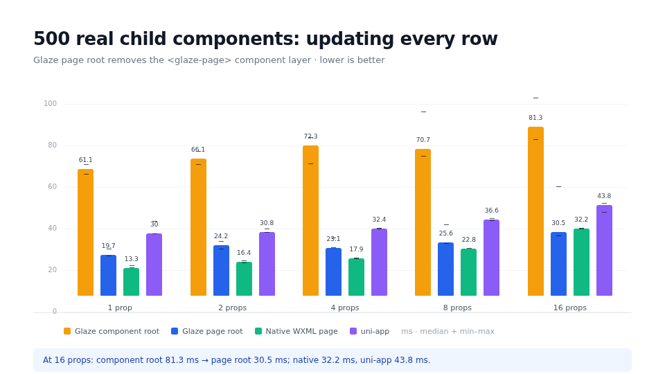

# Page runtime (`pageRuntime: "page"`)

By default a Glaze page is a page entry whose WXML contains one
`<glaze-page>` custom component. The page root component owns the Solid root and
projects its bindings through `Component.setData`. This is safe for every page,
including page events and page context, but it puts the whole page content one
component level below the page.

One nuance matters on glass-easel: a page that has `usingComponents` (which
Glaze always generates) is itself opened as a page-level component by the base
library, not through the legacy `Page.setData` path. The comparison is therefore
**one glass-easel component versus two**, not "Page versus Component". See
[Why removing one level helps](#why-removing-one-level-helps) below.

`pageRuntime: "page"` removes that level for every eligible page. Use
`{ pages: [route, ...] }` to opt in per route; the listed pages run directly and
the rest keep the default component wrapper.

```ts
// glaze.config.mts
const config: GlazeConfig = {
  pageRuntime: 'page',
  // or: pageRuntime: { pages: ['pages/bench/index'] },
}
```

The option is opt-in. The default remains `"component"`.

## Why removing one level helps

This is what the base library actually does for a page on glass-easel:

- `wxapplib`'s `openNewPage` sets
  `customComponentMode = isRouteUsingComponents(route) || componentFramework === 'glass-easel'`
  and calls `ComponentPage.create(...)` instead of the legacy `Page.create(...)`
  (`app-service-engine/src/page/page_manager/pageLifeTime/openNewPage.js`).
- `ComponentPage.create` gets the page instance from
  `adapterPage.addView(route)` and returns its method caller
  (`app-service-engine/src/page/component_page.ts`).
- `WebviewAdapterPage.addView` creates and attaches a root
  `glass-easel` component (`glass-easel-adapter/src/render/webview.ts`).
- `ComponentBuilder.pageDefinition` marks the component with `isPage = true`
  for page style scope, but still builds a normal component definition
  (`glass-easel-adapter/src/builder/component_builder.ts`).
- The legacy `Page.setData` in `app-service-engine/src/page/page.js` deep-copies
  and forwards to `__wxComponentInst__.setData`; it is not the glass-easel page
  update path.

So a component-root page is: page-level component → `<glaze-page>` child
component → 500 child components. A page-root page is: page-level component →
500 child components. The second component level adds a separate shadow root
and one more component boundary for every page update. `isPage` does not switch
the data update implementation; it only changes page style scope.

This explains why `pageRuntime` is competitive with uni-app's page-level
component shape and why it is not universal: a page whose dominant work is a
single field update over a 5000-row list can still be faster with the component
wrapper, as the measured `fine update` result shows.

## What changes

For a direct page the builder writes the page files instead of a wrapper plus a
root component:

| File | Default (`component`) | `page` |
| --- | --- | --- |
| `index.wxml` | `<glaze-page id="app" />` | the compiled page WXML, with the root element carrying `id="app"` |
| `index.js` | `Page({ data: {} })` wrapper | the compiled page module, registering `defineGlazePage` |
| `index.json` | `usingComponents.glaze-page` | the page's own component map |
| `index.wxss` | empty | the compiled page styles |

`defineGlazePage` reuses the component definition built by
`defineGlazeComponent`. Only the host changes:

| Component lifetime | Page method |
| --- | --- |
| `created` | `onLoad` (after the page query is stored) |
| `attached` | `onReady` |
| `ready` | `onReady`, after `attached` |
| `beforeDetach` | `onUnload`, before disposal |
| `detached` | `onUnload` |
| `pageLifetimes.show/hide/resize` | `onShow` / `onHide` / `onResize` |

The page root has no component property bridge, so `props` is empty. `refs`,
bindings, events, async boundaries, `onComponentError`, page visibility, page
size and app visibility use the same runtime code; page-root data updates go
through the page-path transport (or its `setData` bulk fallback).

## When it is used

The builder falls back to the component wrapper when the page needs the page
wrapper's forwarding or property bridge:

- the page or a child uses `usePageOptions`, `usePageEvent` or `onPageEvent`
  (page context);
- the page source references a page event such as `onPageScroll`,
  `onShareAppMessage` or `onPullDownRefresh`.

Static routes are left untouched. A root that is not a `<view>`, or whose
`<view>` already has an `id`, is wrapped in `<view id="app">` instead of
falling back to a component, so the page still runs directly.

## Compatibility detail

The first root `<view>` receives `id="app"` so existing page selectors and
`outerWxml()` checks still work. If the root is not a `<view>`, the builder
wraps the page in `<view id="app">`; the wrapper is a plain WXML node, not a
component, so it does not restore the old component boundary cost.

The page has no `moved` lifetime and no component `error` lifetime. Errors from
bindings and event handlers still reach `onComponentError`; unsupported
component-only hooks are simply absent on a page root.

## Measured result

500 real child components, `update-all`, real tap, in-appservice timing
(`setData` callback, or `wx.nextTick` for page-path batches), minidev (not a
phone). Values are median (min–max) of three runs:

| Prop-shape | Glaze component root | Glaze page root |
| --- | ---: | ---: |
| 1 prop | 61.1 (58.2–63.4) ms | **19.7 (18.9–22.6) ms** |
| 2 props | 66.1 (63–69.7) ms | **24.2 (22.4–26.3) ms** |
| 4 props | 72.3 (63.2–76.3) ms | **23.1 (22.8–27.9) ms** |
| 8 props | 70.7 (66.8–88.7) ms | **25.6 (24.8–34.3) ms** |
| 16 props | 81.3 (75.1–95.2) ms | **32.1 (30.7–37.0) ms** |



The chart also includes the native WXML page and uni-app measured in the same
precise harness: native median is 13.3 / 16.4 / 17.9 / 22.8 / 32.2 ms and
uni-app is 30 / 30.8 / 32.4 / 36.6 / 43.8 ms for 1 / 2 / 4 / 8 / 16 props. At
16 props the component root is 81.3 ms, the page root 32.1 ms, native 32.2 ms
and uni-app 43.8 ms; the page root removes the component-boundary tax but keeps
the per-child work, so native is still slightly ahead.

A separate `bench-component-rows` case (500 stateful children with 8 props)
measured 60.1 ms on the component root and 15.6–23.3 ms on the page root in an
earlier run. In the current 500-row run, `update 100` is 14.1 ms on the
component root and 5.5 ms on the page root; native is 5.3 ms, so this case is
already at the native floor once the page root is selected.

Page root also applies to the other component-heavy fixtures:

| Fixture | Component root | Page root |
| --- | ---: | ---: |
| 1000 pure + 1000 stateful rows | 60.1 ms | **20.4–26.2 ms** |
| 500 props rows, update all | 86.0 ms | **42.9–45.9 ms** |
| 500 props-object rows, update all | 86.1 ms | **35.0–41.8 ms** |

Native WXML measures 17.7 ms, 46.8 ms and 34.4 ms respectively. Page root is at
or below native on the props pages; the remaining 1000+1000 gap is the
per-child Glaze runtime and WXML projection, not the page boundary.

This is simulator evidence. The same-page native comparison (`Page` vs
`Component`) is also simulator-only; real-device confirmation is still needed
before making this the default.

### Page root is not universal

A page with component-dense updates is not the same as a list-heavy page. The
same precise tap measured page root against component root on the move/fine
pages:

| Case | Component root | Page root | Native |
| --- | ---: | ---: | ---: |
| move deep, 2000 rows | 18.9 ms | **14.2 (12.7–17.7) ms** | 13.1–14.2 ms |
| components update 1 | 3.4 ms | 7.6 (4.7–8.1) ms | 3.0 ms |
| props-object update 1 | 3.4 ms | 4.4 (4.0–4.9) ms | 3.4 ms |
| props-object update all 500 | 86.1 ms | **35.0 (34.2–66.2) ms** | 34.4 ms |
| fine update 1 row, 5000 rows | 16.3 ms | 27.9 (20.1–28.9) ms | 16.6 ms |
| fine toggle 1 row | 17.1 ms | 19–24 ms | 14.7 ms |
| fine insert 1 row | 27.1 ms | 24.9–38 ms | 55.9 ms |
| fine delete 1 row | 22.3 ms | 21.4–23.4 ms | 46.2 ms |

So page root removes the wrapper cost when the update is a bounded number of
child property writes, but it is the wrong default for a page whose main cost
is a field update over a 5000-row list. Keep page root opt-in per route and
measure the route's dominant interaction.

The one-row page-root numbers are the other side of the same trade-off. A page
root registers with `Page(page)` in `registerPage`, so its updates go through
the page-level data path. A component root updates the `<glaze-page>` child,
which owns the bindings. The page-path transport now schedules small updates
through `replaceDataOnPath` + `applyDataUpdates`, so `components update 1` is
**3.3–3.7 ms** (previously 7.6–8.1 ms), `props update 1` is **4.8–5.2 ms**
(previously 6.4–8.1 ms). Large fan-outs fall back to one `setData` payload:
`components update all 500` is **17.5–18.7 ms** (previously 17.2–24.2 ms) and
`props update all 500` is **38.4–39.2 ms** (previously 39.5–46.9 ms).
`props-object update all 500` remains in the same 35–53 ms band.

The nested-leaf diff also improves the reactive pages: `grid cell` is
**7.4–8.0 ms** (previously 9.8 ms) and `move deep` is **10.9–11.9 ms**
(previously 12.7–17.7 ms). These are minidev, three-run precise numbers from
`bench/frameworks/run.mjs`; the page-path branch uses `wx.nextTick` as its
acknowledgement, while the component-root rows use the `setData` callback.

Validate with:

```bash
cd examples/solid-todo
mise exec -- pnpm build
cd ~/Playground/minibuild
target/debug/minidev test \
  --project /data/home/nebula/Projects/glaze/examples/solid-todo \
  --browser ~/.cache/ms-playwright/chromium_headless_shell-1248/chrome-headless-shell-linux64/chrome-headless-shell
```

Unit coverage lives in `packages/runtime/test/page.test.ts` and
`packages/build/test/build.test.ts`.
