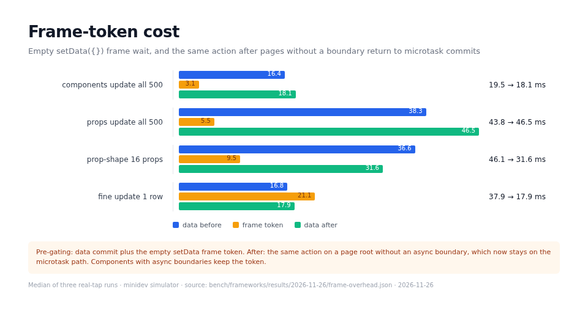

# Runtime edge behavior

This document records the async-boundary and list-diff fixes in
`packages/runtime/src`. They are behavior fixes on top of the existing runtime;
no new architecture was introduced.

## Direction

`defineGlazeComponent` already tracked pending/errored bindings per async
boundary and diffed keyed lists. Four gaps remained around the edges:

- error logging suppressed whenever a component declared `errorBoundary`;
- a manual `NotReadyError` thrown after a binding had already committed did not
  turn Loading back on;
- shared error sources needed regression coverage rather than another mechanism;
- primitive rows could take the keyed-list diff path.

The fixes stay inside `mini.ts` and `list.ts` and add focused tests in
`test/mini.test.ts`.

## Implementation details

### Error logging follows the actual binding boundary

`reportError(state, index, error)` now checks
`state.bindingBoundaries[index]`. A binding with an async boundary surfaces
failures through the Errored state and stays quiet; a binding without one has no
channel, so it still logs through `reportBindingError`. The per-component
`config.errorBoundary` flag was removed; the per-binding boundary id is now the
only suppression condition. Every call site passes the instance state: the
initial mount pass, the memo-backed boundary effect, and the scalar/list binding
effects.

### Committed bindings become probeable for `isPending`

The per-boundary status effect probes `isPending` only for bindings in
`state.settled`, because a memo that has never produced a value cannot answer
the probe. `settled` used to be set only by `applyBinding`, but the first effect
run returns early for values already sent by mount, so a committed boundary
binding stayed unsettled.

`mount` now sets `state.settled[index] = true` when the initial call returns a
value for a boundary binding. After that, a manual `NotReadyError` flips the
memo's pending state, the status effect re-runs through `isPending`, and Loading
becomes true. The next committed value clears it. Initial pending still goes
through `markAsync`'s error channel.

### Shared error sources

`sourceKey` keeps deduping by `error.source`. Two bindings that report the same
source share one entry in `errorValues`/`errorBindings`; `Errored` and
`errorArray` observe that entry. The boundary value signal is only rewritten
when the normalized name or message changes, so a retry with a new message
updates observers without extra signal churn. The regression test checks one
entry, the latest message after a retry, and prompt completion (no flush loop).

### Detach and re-attach

No runtime change was needed here. `detached` disposes the root and drops event
and ref callbacks; `attached` mounts a fresh root and rebuilds handlers, memos,
status projections and effects. The existing context-component test exercises a
boundary-context component across detach/attach and asserts setup ran twice, the
event handler works again, and a memo-backed binding recomputes.

### Row snapshots and in-place mutation

A list binding used to keep `array.slice()`, which preserves the same row
objects. `items[0].done = true` followed by `setItems([...items])` therefore
compared the mutated row against itself and produced no patch. `snapshotList`
now clones each object row deeply, so a direct field mutation and a nested
field mutation are both visible to `listPatch` and become a field path. A
single-field edit sends only that field; a row whose majority of projected
fields changed is sent as one row replacement (see below). A same-shape nested
object or array is diffed down to its changed leaf path; a changed shape
(added/removed key, array length, class instance) travels whole. Prototype-less
data and cycles are handled; class instances beyond arrays, dates and regular
expressions are copied as plain objects, so replace such a row instead of
mutating it.

### Multi-field row replacement

`listPatch` normally emits one data path per changed top-level field, which is
right for the common one- or two-field edit. When a row changes more than two
fields and those fields are a majority of the projected row, it instead emits
one `[binding, index]` replacement carrying the projected row. The child property receives the same row object either way; the
parent just sends 500 paths instead of 8,000 for a 500-row, 16-field update.

On the 500-child prop-shape page this changes the parent's generated list
update from 8,000 field paths to 500 row paths at 16 props. The wall-clock
numbers from the 50ms polling harness are not used as CPU evidence; use
`bench/frameworks/run.mjs --precise` for in-appservice `setData` timing.

### List view-model projection

`listFields` metadata from the compiler is applied by `projectList` in
`list.ts`. `applyBinding` projects before `listPatch` / `listOps`, and `mount`
projects before the initial `setData`; `state.previous` and the data copy both
hold a detached projection. The projection only copies the recorded top-level
fields and always keeps the key.

The event path is unchanged: `scope.jsSource` still indexes the original
application array, so a row handler sees fields that are not rendered. If any
row is a primitive, array, class instance, `Date`, `RegExp` or another
non-plain object, `projectList` returns the original array instead. That keeps
the optimization from changing list semantics.

The fine benchmark's initial list payload drops from 10,270,281 bytes to
215,281 bytes; the 5000 rows keep `id`, `title` and `done`, and the unused 2 KB
`extra` field is absent from component data. Minidev's first-render timer is
dominated by WXML node creation, so this does not produce a large wall-clock
change in the simulator; the payload reduction is measured directly on the
generated data object.

### Props-only projection parity

Props-only expressions are compiled directly into WXML, while local-state
expressions stay on the `bN` binding path. To keep the two evaluation paths
from drifting, `packages/runtime/test/projection-parity.test.ts` compiles the
expression, mounts the generated WXML in glass-easel, and compares the rendered
text with the equivalent JavaScript value for `undefined`, `null`, `false`, `0`,
`NaN`, number/string concatenation and structured-prop fallback. The test also
asserts `bindingCount === 0`, so a case cannot pass by silently taking the
binding path. This is a semantic spot-check, not a proof for arbitrary WXML
expressions; unsupported syntax falls back to a binding rather than projecting.

### Effect, memo and glass-easel parity tests

`packages/runtime/test/glass-easel-parity.test.ts` mounts the same WXML twice
for each case: once with a Glaze component and once with a direct glass-easel
component driven by `setData`. It compares data and rendered rows after scalar
updates, keyed list patches/splices, a keyed reorder, nested object updates,
conditional branches and a child-property update. The keyed reorder case also
asserts that the row node for a retained key is the same element in both
implementations. This exercises the actual transport and glass-easel template
engine rather than a fake instance.

The two implementations intentionally differ in timing: direct `setData` is
synchronous, while Glaze commits through its scheduler (and, in the test
harness, glass-easel's 16 ms backend render callback). The test asserts that
the Glaze view still holds the old value immediately after a signal write and
matches direct `setData` after settling. A 100 ms settle window is used for the
two-stage test harness, not as a production timing claim.

`packages/runtime/test/mini.test.ts` adds effect/memo contracts: two bindings
sharing one memo compute it once; an unrelated signal does not recompute it;
multiple signal writes in one tick produce one transport batch with final
values; and a user effect's cleanup runs on detach while the effect does not
run during the detached period. These are runtime-level tests with the
lightweight instance, separate from the glass-easel rendering parity above.

### Initial list data must not alias app state

The platform applies `replaceDataOnPath` by mutating the component data object
in place. When the runtime `setData`s generated `bN` keys, glass-easel stores the
array reference directly for those new data fields, so a later field patch such
as `['b0', 0, 'title']` would also mutate the signal's source array. Re-entering
the page then started from data already changed by the previous run.

`mount` now sends a fresh `snapshotList` copy for every list binding. The initial
pass already snapshots the value for diffing, so this is one extra copy per list
binding at mount; update paths are unchanged. The regression test
`initial list data is detached from the source array` mutates the data copy and
asserts the source row is untouched.

The same rule now holds for every list update, not only the initial write.
`materialize` builds a detached payload for `*this` and unkeyed lists too, and
keeps a second snapshot as the diff baseline. When `projectList` produced fresh
plain rows and every projected field is primitive, the payload can reuse those
rows and only the baseline is snapshotted; a nested value or a `projectList`
fallback keeps the two-snapshot path. See
[`runtime-transport.md`](runtime-transport.md).

### Path transport for page roots

When a page root exposes `replaceDataOnPath` and `applyDataUpdates` but no
`groupUpdates`/data proxy, the runtime uses a `page-path` transport: up to 64
changes are scheduled with `replaceDataOnPath` and flushed once with
`applyDataUpdates()`; a larger batch falls back to one `setData` payload because
per-path scheduling is not cheaper at fan-out. This transport never advertises
splice capability, so structural list changes still send the whole `bN` value.
The grouped and data-group transports remain preferred when available.

### Loading on and Errored reset

`ctx.loadingOn(boundary, read)` creates a runtime effect for the `on`
dependency. After the first run, a change calls `armLoading`, which marks the
boundary pending only if a binding under that boundary is actually pending. The
retained content stays visible; content writes are held while the fallback is
shown, but there is no render-effect frame, so an `on` change with nothing
pending does not fabricate a spinner.

`ctx.reset(boundary)` clears the boundary's pending and error maps, writes the
status signals, then bumps a per-boundary reset signal. Every binding memo reads
that signal, so reset retries failed expressions even when their ordinary
dependencies did not change. The `Errored` fallback receives a generated reset
function; the compiler rewrites the fallback parameter to a setup constant that
calls `ctx.reset`.

### Async boundary kinds

A binding stores two boundary ids: the nearest `Loading` and the nearest
`Errored`. Pending uses the loading id; failures and `Errored` values use the
error id. That is what lets an outer `Errored` catch a failure inside an inner
`Loading`, and an outer `Loading` show pending work inside an inner `Errored`,
while same-kind nesting still follows the nearest boundary.

A `Loading` boundary also keeps a `settled` signal. It becomes true only after
every binding under that boundary has delivered a first value. The compiler
projects `ctx.hasValue(id)` into its own status binding; the generated fallback
condition is `loading && !hasValue`, so a refetch keeps the mounted content and
only an initial load shows the fallback. `ctx.hasValue` stays true across a
reset, because a reset is a refetch, not a remount. `clearBoundaryContent`
resets it on remount.

Status and data share one `applyBinding`/transport queue. The old
`queueMicrotask` status projection is gone; `applyAsyncStatus` receives the new
boolean explicitly, which is necessary because Solid stages signal writes until
the current flush ends.

### Real boundary tree

The compiler now emits `boundaries` descriptors alongside `asyncStatus`.
`mount` builds the tree after creating the per-binding memos, using Solid's
`createLoadingBoundary` and `createErrorBoundary` from `solid-js/internal`.
Each boundary's content function reads its direct `content` bindings and calls
the output of each content-region child boundary; fallback-region boundaries
are built but deliberately not called. This gives nearest-boundary pending,
first-load fallback, and nearest error catching to the real Solid primitives
instead of to a parallel map.

`BoundaryState` is still present: it owns the refetch `isPending` probe, the
`hasValue`/settled signal, the `loadingOn` dependency effect, the reset version,
and the component error observer. `applyAsyncStatus` combines the real
boundary's fallback with that state, so status and data still land in one
transport batch. The WXML conditions are unchanged, and the tree adds no DOM or
second render path.

This is not a full boundary-output projection. The fallback and content are
still WXML branches in the same data object; there is no transition or
per-boundary effect attach/detach. Content writes are held while the fallback
is visible and released when the boundary returns to content, which is a
data-level held frame rather than Solid's render-effect frame. A boundary in
another mini-program component has its own Solid root, and a boundary inside a
loop has no per-row owner.

For a list, each row needs its own instance-level boundary. Render a row
component from `<For>` and put its async memo plus `Loading`/`Errored` inside
that component; the component's root owns one binding set and status map, so
pending, errors and reset are independent per row. A boundary placed directly
inside `<For>` is still rejected because the loop template has no per-row JS
execution or owner.

### Async requests with flight and abort

`createRequest` is the runtime helper for imperative requests such as
`wx.request`. It owns `data`, `error`, and `pending` signals and guarantees that
only the latest flight can write them:

```tsx
import { createRequest } from '@glaze/runtime'

const user = createRequest(() => {
  let task: WechatMiniprogram.RequestTask | undefined
  const promise = new Promise<User>((resolve, reject) => {
    task = wx.request({
      url: `/api/users/${id()}`,
      success: (response) => resolve(response.data as User),
      fail: reject,
    })
  })
  return { promise, abort: () => task?.abort() }
})
```

`run()` aborts the previous task, clears the previous error, and marks pending.
A late response from an older flight is ignored. `abort()` keeps the last data,
clears pending, and does not invent an error. When created inside a reactive
owner, the helper also aborts the current task on cleanup, which makes it safe
for row components that disappear from a list. The helper does not create a
Solid memo, so it does not drive a `Loading` boundary by itself; use a memo for
boundary integration and `createRequest` for explicit `pending`/`error` UI.

### Async diagnostics

The compiler emits `GLAZE_UNTRACKED_READ_AFTER_AWAIT` when an async computation
reads `props` after its first `await`. Solid records dependencies only before
that point, so the read would never retrigger. Read the value into a local
first, or move the async work into a memo that reads its inputs before awaiting.

### Context readers

`withProvider` accepts an optional `read` callback and wraps it in a context
reader. `withBoundaryContexts` passes a reader for each context key, so a child
sees later provider values without remounting. The compiler routes every
generated `useContext` through `ctx.context`, which returns the reader (or wraps
a default value in one). Object and primitive context values therefore behave
the same; destructuring still snapshots the current value.

### Primitive list rows

`listOps` returns `null` when either array contains a non-object item, and
`listPatch` already rejected primitive rows. `applyBinding` treats `null` as a
whole-array replacement, which is the only unambiguous result when rows have no
key to align on. `key === '*this'` continues to return `null` from both helpers.
The tests cover `[1, 2] -> [1, 3]` and `[1, 2] -> [2, 1]` at the helper and
runtime levels.

### Duplicate and missing list keys

`listOps` and `listPatch` now reject a keyed list when any key repeats or is
missing. A duplicate key makes both node identity and a field path ambiguous;
a missing key is the same case with every row at `undefined`. The caller then
sends the whole `bN` array instead of a patch or splice. A key field that
changes in place is already handled as a remove plus insert by `listOps`, not
as a field patch, because the old and new rows no longer align on that key.

### Runtime state models

The per-instance state is split across three modules used by `mini.ts`:

- `state.ts` owns `core.bindings`, a sparse `BindingList`. Each `BindingState`
  keeps `raw` (the direct read), `read` (the effect source, memo-unwrapped),
  `memo`, `initial` (raw mount value), `previous` (projected baseline),
  `settled`, both boundary ids, `source` and `fallbackSource`. Mount resets
  entries in place with `resetBindingStates` and never compacts the list;
  iterations skip entries whose `raw`/`read` is null.
- `boundary.ts` owns the boundary-keyed pending/consumer/error maps and the
  lazily created loading/settled/errored/error-value/reset signals plus
  `loadingOn`.
  `markPending`, `markSettled`, `markError`, `clearError` and `resetBoundary`
  replace the former inline map/signal code. `clearBoundaryContent` is the
  remount reset and keeps signal and reset-counter identity.
- `lifecycle.ts` replaces `mounted`/`active`/`everMounted` with
  `unmounted | waiting-context | mounted | attached | detached`.
  `waiting-context` carries `attachedBeforeMount`, because the platform's
  `attached` can run before a deferred root exists. The phase tracks platform
  attachment, not installed effects: `ready` always mounts and attaches, so a
  `mounted` phase can already have effects.

`schedule` still flushes only when the platform is attached (phase `attached`,
or `waiting-context` with `attachedBeforeMount`), matching the old `active`
flag. `applyBinding` ignores a projection for an index with no binding yet;
this only matters for a deferred `attached` event followed by `ready` later in
the same tick, where the projection is rerun after mount and component data is
unchanged.

### Mini-program lifecycle mapping

Glass-easel component lifetimes are the only platform hooks the runtime
subscribes to. The mapping is:

| Platform | Runtime behavior |
| --- | --- |
| `created` | Create `InstanceState`, prop signals and the props proxy. A non-deferred glass-easel component mounts its Solid root here; a legacy exparser component waits for `attached` because its parent props are assigned after `created`. |
| `attached` | Deferred context: record `attachedBeforeMount` only. Legacy exparser: re-seed props and mount before installing effects. Normal: install effects. After `detached`: rebuild the root, then install effects. |
| `ready` | Deferred context: build the root and install effects once. Already rooted: no-op. After `detached`: ignored, so a late ready cannot revive a detached root. |
| `moved` | Keep the same root and signals, then notify `onComponentMoved` / `ctx.onComponentMoved` handlers. |
| `beforeDetach` | Notify `onBeforeDetach` / `ctx.onBeforeDetach` handlers while the root is still alive. Teardown still happens at `detached`; glass-easel detaches children first, so a parent's `onCleanup` runs after its child components are already detached. |
| `detached` | Dispose the Solid root, clear pending writes, events/refs, error handlers, page handlers, page-channel subscriptions and status projection, and move to the `detached` phase. |
| `error` | Store the error in `state.error` and notify every `ctx.onComponentError` handler. Binding failures now use the same observer in addition to their `Errored` channel. |
| `pageLifetimes` (`show`, `hide`, `resize`, `routeDone`) | Drive `ctx.pageVisible()`, `ctx.pageSize()` and the `routeDone` page event; `pageSize` is seeded from `wx.getWindowInfo()` when available. |

Page-level events that are not component page lifetimes (`onPageScroll`, share
callbacks, `onPullDownRefresh`, `onReachBottom`, `onTabItemTap`,
`onSaveExitState`) are forwarded by the generated page wrapper to the root
component's `__glazePageEvent` method when a compiled source references them.
The wrapper caches the root component once `selectComponent('#app')` succeeds.

Projects that set `componentFramework: "exparser"` in `app.json` use the same
mapping with one timing change: the root is created at `attached`, after the
legacy parent has assigned props. See [Legacy exparser](exparser.md).

With `pageRuntime: "page"`, the page itself is the root component. The same
`created` / `attached` / `detached` paths run from `onLoad` / `onReady` /
`onUnload`; pages with page context or page events keep the default wrapper.
See [Page runtime](page-runtime.md).

### Page context channel

When a page or any component uses `usePageOptions`, `usePageEvent` or
`onPageEvent`, the build marks the page and every boundary on the path to that
component as `pageContext`. The page wrapper then owns a per-instance id and
query and passes them to the root as one object property:

```xml
<glaze-page id="app" glazepage="{{__glazePage}}" />
```

The runtime registers every page-context component under that page id. Page
events are stored in one `PageChannel` per id, so a child component observes
`usePageEvent('scroll')` without receiving a copy of page state and pages in the
navigation stack cannot see each other's events. The id is generated in
`onLoad`, so a component that mounts before it can still subscribe; the read
waits on the `glazepage` property and joins the channel when the id arrives.
Only components on the path to a page hook receive the property; unrelated
boundaries keep the old shape. A page root removes its channel at `detached`.

The channel deliberately does not call `getCurrentPages()`: the top page is
ambiguous while several pages are alive and would route a hidden page's event
to the visible one.

### Page visibility, page events and component errors

Page-level state is exposed through setup-only hooks, so normal TSX
components do not need the generated `ctx` object. The project must declare
`@glaze/runtime` as a dependency when it imports these hooks.

```tsx
import { createEffect } from 'solid-js'
import {
  onAppError,
  onAppHide,
  onAppShow,
  onComponentError,
  onPageEvent,
  onUnhandledRejection,
  useAppVisible,
  useLaunchOptions,
  usePageEvent,
  usePageOptions,
  usePageSize,
  usePageVisible,
} from '@glaze/runtime'

export default function Page() {
  const pageVisible = usePageVisible()
  const pageSize = usePageSize()
  const appVisible = useAppVisible()
  const options = usePageOptions()
  const scroll = usePageEvent('scroll')

  createEffect(() => {
    if (!pageVisible() || !appVisible()) pauseTimers()
  })
  createEffect(() => {
    const size = pageSize()
    if (size) layout(size.windowWidth, size.windowHeight)
  })
  createEffect(() => {
    const page = options()
    if (page) trackPageQuery(page.query)
  })
  createEffect(() => {
    const event = scroll()
    if (event) trackScroll(event.scrollTop)
  })
  onPageEvent('shareAppMessage', () => ({ title: 'Glaze page' }))
  onComponentError((error) => reportToTelemetry(error))

  return <view>...</view>
}
```

Hand-written `defineGlazeComponent` components use the same values as
`ctx.pageVisible()`, `ctx.pageSize()`, `ctx.appVisible()`,
`ctx.pageOptions()`, `ctx.appLaunchOptions()`, `ctx.onAppShow(handler)`,
`ctx.onAppHide(handler)`, `ctx.onAppError(handler)`,
`ctx.onUnhandledRejection(handler)`, `ctx.pageEvent(name)`,
`ctx.onPageEvent(name, handler)`, `ctx.onComponentError(handler)`,
`ctx.onComponentMoved(handler)` and `ctx.onBeforeDetach(handler)`.

- `usePageVisible()` starts `true`, then follows `pageLifetimes.hide` and
  `pageLifetimes.show`.
- `usePageSize()` is the last `pageLifetimes.resize` payload, seeded at
  creation from `wx.getWindowInfo()`; it is `null` when neither is available.
- `useAppVisible()` follows `wx.onAppShow` / `wx.onAppHide`; the listeners are
  installed once per `wx` object on first use, and the value starts `true`.
- `useLaunchOptions()` returns the immutable options captured from
  `wx.getLaunchOptionsSync()`; it is `undefined` when the base library does not
  expose that API. `onAppShow` receives the show options separately.
- `onAppShow(handler)` / `onAppHide(handler)` run on `wx.onAppShow` /
  `wx.onAppHide`; `onAppError(handler)` and `onUnhandledRejection(handler)`
  bridge `wx.onError` / `wx.onUnhandledRejection`. Their unsubscribe functions
  are also run when the component root is disposed.
  `onUnhandledRejection` receives `event.reason` when present.
- `usePageOptions()` returns the owning page's `{ id, query }` when the
  component is inside a page-context subtree; it is `undefined` otherwise.
  Query values come from the page wrapper's `onLoad(query)`.
- `usePageEvent(name)` reads the latest payload of a page event. The event
  names are `scroll`, `shareAppMessage`, `shareTimeline`, `addToFavorites`,
  `tabItemTap`, `saveExitState`, `pullDownRefresh`, `reachBottom` and
  `routeDone`. Page-context components share the page's channel, so a child
  can read the event directly.
- `onPageEvent(name, handler)` returns an unsubscribe function. Its return
  value is forwarded for page methods that expect one (`onShareAppMessage`,
  `onShareTimeline`, `onAddToFavorites`, `onSaveExitState`). The channel is
  shared across the page-context subtree; `routeDone` also continues to reach
  every component through `pageLifetimes`.
- `onComponentError(handler)` receives glass-easel errors and binding failures;
  binding failures also keep their `Errored` channel.
- `onComponentMoved(handler)` runs when the component is moved in the node tree;
  the root and signals are not rebuilt.
- `onBeforeDetach(handler)` runs before the root is disposed.
- Hooks must be called during `setup`; calling them from an event handler or a
  later effect throws.
- Handlers are cleared when the root is rebuilt or detached; register them in
  setup beside the effects that use them.

The real glass-easel tests cover the normal `attached` -> `ready` order,
`ready` before `attached`, `detached` before `ready` (no late mount),
`detached` -> `attached` -> `ready` (rebuild once), a `moved` component keeping
its root and firing its hook, `beforeDetach`, `routeDone`, page resize, and the
error lifetime.

### Replaced error sources release the old consumer

`binding.source` remembers the last source this binding reported. When a later
failure resolves to a different source, `markAsync` clears the binding's
consumer for the old source before registering the new one. Without that, the
old source kept its consumer after the new source recovered and `Errored`
stayed true (A -> B -> success). Status is re-projected only when the boundary
had consumers before the clear, and the new-source registration keeps its own
projection; the test asserts `errored` and `error` are false/null after
recovery.

### Effects install once per root

`InstanceState.effectsInstalled` guards `attach`. `ready` before the platform's
`attached` mounts and installs effects while the phase is still `mounted`; the
later `attached` still advances the phase to `attached` but skips a second set
of binding effects. `attach` also returns early when there is no root or owner,
so the `waiting-context` attach (before `ready`) cannot count as installed. The
flag resets in `mount` and on `detached`, so a rebuilt root installs a fresh set
once. The regression test updates one signal after `ready` + `attached` and
asserts the binding read ran once.

### Frame-aligned commit scheduling

`packages/runtime/src/frame.ts` resolves one commit scheduler per attached
instance. In a mini-program lifetime `this` is the platform's
`ComponentCaller`, so the glass-easel backend is not directly reachable; its
`setData` callback is routed through glass-easel's `triggerRender`
(`glass-easel-adapter/src/subcontext/component.ts`) and finally through the
backend's `render` (the view-side `requestAnimationFrame`, see
`glass-easel/src/render.ts` and `current_window_backend_context.ts`). The
runtime therefore uses an empty `setData({}, callback)` as a frame token. When
a host exposes the backend directly (real glass-easel components in tests), that
path is used instead.

The runtime waits for that callback before flushing `state.pending`, so every
binding change collected in the same frame reaches `applyBinding`/the transport
as one batch. Status and data therefore land in the same commit window, and the
old view values stay visible until the frame callback instead of being replaced
in an earlier microtask.

The scheduler is enabled only when the component has an async boundary, where
status and content share one commit window. A page root or a list-heavy
component root without a boundary keeps the microtask path: the frame token
measured 3–21 ms depending on the page, which is worse than the
intermediate-state risk it removes when there is no fallback/content pair to
protect.

The scheduler falls back to a microtask when the host is an exparser component
or exposes neither a backend nor a `setData` callback. The callback is an
adapter-internal hook, not a public mini-program API. The `setData` token also
has a 100 ms timeout: a host that accepts the call but never invokes the
callback would otherwise leave `pending` unflushed forever. A late callback is
ignored after the timeout flush.

This is frame-aligned data commit, not a render-effect or paint-complete hook.
It cannot keep WXML branch nodes alive, make several component roots commit
atomically, or give `startTransition`/`latest` their timing. It only removes
multiple `setData` commits from one frame and gives `keepPrevious` a cleaner
`old view -> next frame` boundary.

Measured cost of the empty `setData` frame token (three real-tap runs, median;
minidev simulator, not a phone):

| Case | data before | frame token | before total | after (no boundary) |
| --- | ---: | ---: | ---: | ---: |
| components update all 500 | 16.4 ms | 3.1 ms | 19.5 ms | 18.1 ms |
| props update all 500 | 38.3 ms | 5.5 ms | 43.8 ms | 46.5 ms |
| prop-shape 16 props | 36.6 ms | 9.5 ms | 46.1 ms | 31.6 ms |
| fine update 1 row | 16.8 ms | 21.1 ms | 37.9 ms | 17.9 ms |

The `props` after-run is within run noise of the before total; the other three
cases lose the token without a data regression. The 5000-row fine page was the
clearest case: its ~21 ms token was removed by the same gating. Only components
with async boundaries still pay for the frame. The raw runs and chart script
are in `bench/frameworks/results/2026-11-26/frame-overhead.json` and
`bench/frameworks/chart.mjs`.



### Waiting for a platform data commit

`ctx.commit()` returns a promise that resolves after the next pending data batch
has been handed to the platform transport. Inside TSX, `useCommit()` returns the
same function; `ctx` itself is the compiler-generated setup parameter and is not
part of the component authoring API. It is the explicit boundary between Solid
state and the mini-program `data` object:

- a signal write first runs its Solid effect, which queues binding changes;
- `commit()` waits for that queue plus the scheduler in use (microtask, or the
  view frame for a component with an async boundary);
- it resolves after `transport.apply` succeeds, so a following `this.data`,
  `selectComponent().data` or native-property read sees the committed values;
  selector queries and node operations still depend on the platform's view-side
  update, which commit does not wait for;
- it rejects when the component detaches before the batch commits, when the
  transport throws, or when it is called without an attached component;
- with no pending changes it resolves immediately after one microtask.

The promise means "data committed", not "paint complete". Direct
mini-program `setData` also stops at the appservice data object; the view
layer still updates through the platform's own bridge. `ctx.commit()` removes
the Glaze-specific scheduling gap, not the platform's rendering latency.

Application code still should treat Solid signals and stores as the source of
truth, not `data`. `commit()` is for the places where a platform API or native
component requires the data object, for example a page share payload assembled
from generated data or a native interop probe. Normal events, derived values
and child props should read signals, memo accessors or `props`.

```tsx
import { useCommit } from '@glaze/runtime'

function ShareButton() {
  const commit = useCommit()
  const [title, setTitle] = createSignal('initial')

  const publish = async () => {
    setTitle('updated')
    await commit()
    // A platform API that reads the committed data object can run here.
  }

  return <button onClick={publish}>{title()}</button>
}
```

### Config validation

`defineGlazeComponent` validates the generated config before it builds any
state. It rejects names that collide after lowercasing, `propSignals` entries
that are not declared properties (including the internal `glazeprops` and
`glazecontext` names when structured props or boundary contexts are in use), a
non-positive `bindingGroupSize`, a negative `handlerCount`, malformed
`listBindings`/`listFields` pairs, and invalid `asyncStatus` indexes, boundaries
or kinds. These are all cases where the old runtime would silently build the
wrong signal set or skip a generated feature.

## Reveal coordination

`<Reveal>` is compiled into a runtime group and a list of direct `Loading`
boundary ids. Setup calls `ctx.revealGroup(order, collapsed, slots)` before any
binding is registered; `order` and `collapsed` are accessors, so reactive
values re-derive the group.

`packages/runtime/src/reveal.ts` keeps a `createMemo` per group that reads the
boundary signals through `settledOf` and `loadingOf`, plus the order and
collapsed accessors. A slot is ready when it
has delivered a first value or has nothing pending. The memo returns
`{ gated, hidden }` per slot; the compiler creates one ordinary binding for
`ctx.revealGated(boundary)` and one for `ctx.revealHidden(boundary)` per slot.
The WXML `Loading` conditions combine those bindings with the existing
`loading`/`hasValue` conditions.

This is intentionally not a Solid boundary-output clone. Solid's controller
forces state directly on boundary outputs, holds the previous frame, and
graduates slots as their content is shown. Glaze has no boundary output object;
it projects the same order through data bindings and therefore inherits the
mini-program transport's commit timing. The user-visible semantics are the
same for `sequential` / `together` / `natural`, frontier fallback, and
collapsed tails; a frame-level content hold beyond the aligned data commit is
not promised.

## Trade-offs

- Logging no longer reads a component-wide flag. `config.errorBoundary` is
  gone from the contract; behavior derives from each binding's boundary id,
  which is what distinguishes mixed components.
- `settled` is established at mount instead of removing the guard in the status
  effect. Probing an uninitialized memo can suspend instead of answering false,
  so the guard is required.
- The primitive guard scans each array once. That is negligible next to a list
  splice and prevents ambiguous ops for rows that cannot be keyed.
- The generated page wrapper defines only the methods whose event names appear
  in compiled sources; a dynamic or aliased hook enables the full set. Share
  methods therefore enable the share menu only on pages that register them.
- The frame scheduler depends on glass-easel's adapter-internal `setData`
  callback (or a directly exposed backend); it is feature-detected every attach
  and falls back to a microtask. It is not a public mini-program contract.
- The frame token is an empty `setData`, which costs one render request per
  batch but no data change; it is not a second data commit.
- Frame-aligned commit adds one view-frame of latency to non-initial updates.
  That is the trade for removing multiple commits inside one frame; mount data
  still goes through the initial `setData` immediately.
- App visibility uses one module-level signal per runtime copy and `wx.onAppShow`
  / `wx.onAppHide`; there is no per-page app listener.

## Validation

```
pnpm --filter @glaze/runtime test
# tests 268, pass 268, fail 0 (includes frame scheduler and boundary tests)
pnpm --filter @glaze/runtime typecheck
# tsc --noEmit -p tsconfig.json (no output)
pnpm --filter @glaze/build test
# tests 126, pass 126, fail 0
cd examples/solid-todo && pnpm build
# glaze build: 25 pages, 52 components
# minidev e2e: 14 cases, 14 passed (the context case scrolls and asserts the root sees the page event)
```
